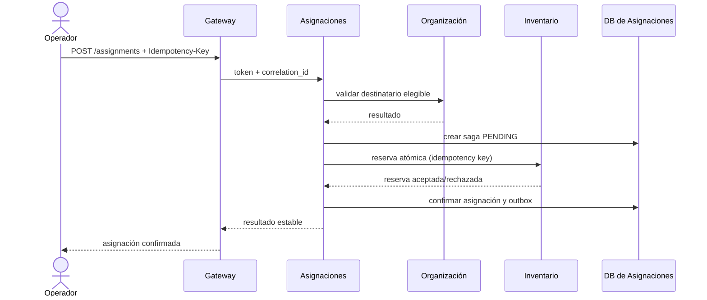

# APIs y modelo de datos inicial

Este documento establece la primera superficie de integración y las tablas propiedad de cada servicio. Los nombres/versiones son contratos de diseño que se validarán con OpenAPI y migraciones por servicio antes de cada flujo funcional. Todas las rutas web llevan prefijo `/api/v1`; los servicios internos no se exponen directamente al navegador.

## Superficie HTTP

| Contexto | Operaciones externas iniciales | Operaciones internas / eventos |
|---|---|---|
| Identidad | `POST /auth/login`, `/auth/refresh`, `/auth/logout`; `GET /users/me`; administración `GET/POST /admin/users`, `PATCH /admin/users/{id}`, `GET/POST /admin/roles`, asignación de permisos | Emisión/rotación/revocación de token; OIDC/JWT según ADR al implementar |
| Catálogo | `GET/POST /products`; `GET/PATCH /products/{id}`; `POST /products/{id}/deactivate`; `GET/POST /categories`, `GET /units` | Publica producto creado/actualizado |
| Compras | `GET/POST /suppliers`; `GET/POST /purchase-orders`; `GET/PATCH /purchase-orders/{id}` solo en borrador; acciones `/submit`, `/approve`, `/cancel`; `POST /purchase-orders/{id}/receipts`; `GET /receipts/{id}` | Consulta catálogo por API; publica recepción aceptada vía outbox |
| Inventario | `GET /stock?product_id=&location_id=`; `GET /assets`; `GET /assets/{id}`; `POST /receipts` para ingreso manual autorizado; `POST /adjustments`; `POST /transfers`; `POST /assets/{id}/reservations`; `DELETE /assets/{id}/reservations/{reservation_id}` | Consume recepciones de compras y restricciones; emite movimientos y resultado de reserva |
| Organización | `GET/POST /groups`; `GET/PATCH /groups/{id}`; `GET/POST /employees`; `GET/PATCH /employees/{id}`; `/groups/{id}/memberships` | Consulta de elegibilidad de colaborador/grupo y eventos de cambios relevantes |
| Asignaciones | `GET/POST /assignments`; `GET /assignments/{id}`; `POST /assignments/{id}/confirm`; `POST /assignments/{id}/returns`; `POST /assignments/{id}/transfers` | Llama a reserva de Inventario y elegibilidad de Organización; expone estado de saga; publica hechos confirmados |
| Inspecciones | `GET/POST /templates`; `GET/POST /schedules`; `GET /inspections`; `GET /inspections/{id}`; `PUT /inspections/{id}/answers`; `POST /inspections/{id}/submit`; `POST /incidents/{id}/resolve` | Job idempotente genera ejecuciones; notifica; solicita bloqueo/liberación a Inventario |
| Mantenimiento | `GET/POST /work-orders`; `GET /work-orders/{id}`; `POST /work-orders/{id}/start`; `POST /work-orders/{id}/complete`; `POST /work-orders/{id}/release-request` | Responde incidencias; solicita y confirma transiciones de Inventario |
| Notificaciones | `GET /notifications`; `PATCH /notifications/{id}/read`; actualización de preferencias propias | Suscriptor asíncrono; proveedor de correo detrás de puerto de salida |
| Reportes | `GET /reports/inventory`; `/groups/{id}`; `/employees/{id}`; `/inspections`; `/maintenance`; `POST /exports` y `GET /exports/{id}` | Lee solo proyecciones locales; informa `generated_at`/`data_as_of` |
| Auditoría | `GET /audit-events` con filtros por rango, actor, acción, contexto y entidad | Ingesta interna autenticada e idempotente de hechos permitidos |

Las rutas y permisos concretos se especifican por operación (`catalog.product.read`, `catalog.product.create`, `procurement.order.approve`, `inventory.asset.reserve`, etc.). `POST` que crea o coordina operaciones de riesgo acepta `Idempotency-Key`; repetición devuelve el resultado asociado. Errores HTTP usan un formato común `type`, `title`, `status`, `detail`, `correlation_id` y errores de validación con campos explícitos.

## Persistencia por propietario

Todas las entidades usan UUID y tiempos UTC. Cada servicio añade `created_at`, `updated_at` y versión optimista donde una actualización concurrente pueda perder cambios. FK solo dentro de la base dueña. Las siguientes tablas son propuestas iniciales, no un esquema global.

| DB de servicio | Tablas y relaciones locales principales |
|---|---|
| `identity_db` | `users`; `roles`; `permissions`; `user_roles` (N:M); `role_permissions` (N:M); `refresh_sessions` (hash de token, expiración/revocación); `login_attempts` (retención limitada); `outbox` |
| `catalog_db` | `categories` (jerarquía parent_id local); `units`; `products` (category_id, unit_id, tipo de seguimiento, estado, versión); `product_attributes` (atributo y valor tipado/validado); `product_images` (metadatos y clave de objeto, no binario); `outbox` |
| `procurement_db` | `suppliers`; `purchase_orders`; `purchase_order_lines` (product_id externo, descripción/código snapshot, qty/precio/impuesto/descuento); `approvals`; `receipts`; `receipt_lines` (recibido/aceptado/rechazado/dañado); `documents` (metadatos); `outbox`; `inbox` |
| `inventory_db` | `locations`; `product_snapshots` (ID externo y versión); `stock_balances` (producto + ubicación únicos); `assets` (producto, serial/código, ubicación, estado, versión); `movements` (append-only); `reservations`; `asset_restrictions` (referencia externa, razón/ciclo de bloqueo); `processed_receipts`; `outbox`; `inbox` |
| `organization_db` | `groups`; `employees` (identificador y PII mínima); `departments`; `sites`; `positions`; `memberships` (group_id, employee_id, inicio/fin; índice para relación activa); `outbox` |
| `assignment_db` | `assignments` (asset_id, destinatario referencia, estado y reserva); `assignment_events`/historial; `returns`; `transfers`; `handover_documents`; `saga_steps`; `outbox`; `inbox` |
| `inspection_db` | `templates`; `template_versions`; `questions`; `schedules`; `inspection_occurrences` (clave única programa/activo/periodo); `inspections`; `answers`; `evidence_metadata`; `incidents`; `outbox`; `inbox` |
| `maintenance_db` | `requests`; `work_orders`; `diagnoses`; `work_order_tasks`; `parts` (referencia de catálogo/inventario); `cost_items`; `evidence_metadata`; `outbox`; `inbox` |
| `notification_db` | `notification_preferences`; `notifications` (destinatario y clave origen); `delivery_attempts`; `inbox`; `outbox` |
| `reporting_db` | `projection_offsets`; proyecciones desnormalizadas para inventario, grupos, asignaciones, inspecciones y mantenimiento; `export_jobs`; `inbox` para checkpoint/evento |
| `audit_db` | `audit_events` (actor, servicio, acción, referencia, outcome, correlation_id, timestamp y campos redactados); índices por actor/entidad/fecha; `inbox` |

`outbox` e `inbox` son técnicas y locales a cada base, no compartidas. Las referencias como `product_id`, `employee_id` y `asset_id` no generan FK entre servicios. En inventario, las unidades controladas por cantidad actualizan `stock_balances`; las de control individual crean una fila por unidad en `assets`. El modelo nunca crea activos ficticios para consumibles por cantidad.

## Integración de operaciones críticas

Si el paso de reserva falla, Asignaciones no confirma; una compensación libera una reserva huérfana y deja evidencia. Recepción usa el mismo límite local: Compras confirma recepción aceptada en su DB + outbox; Inventario deduplica por recepción/línea y crea sus movimientos. Una transacción de un servicio nunca incluye SQL o locks de otro.
