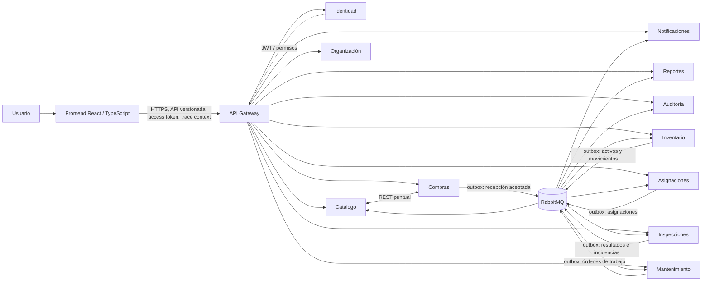
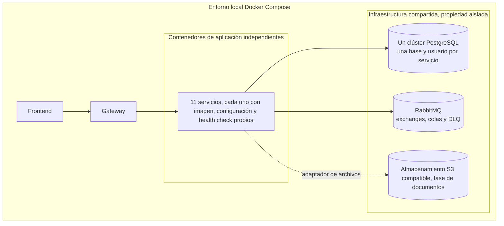

# Arquitectura objetivo

## Principios

1. Cada servicio es dueño de sus reglas, datos y migraciones.
2. Una base de datos compartida físicamente no implica propiedad compartida: no hay lecturas, escrituras, claves foráneas ni transacciones cruzadas entre servicios.
3. La API Gateway enruta y aplica políticas de borde; no implementa procesos del negocio.
4. Cada backend separa dominio, aplicación, puertos, adaptadores y composición de infraestructura. El dominio no importa FastAPI, SQLAlchemy, RabbitMQ ni clientes HTTP.
5. HTTP se reserva para decisiones que requieren respuesta inmediata. RabbitMQ distribuye hechos de negocio confirmados.
6. Toda operación distribuida tolera duplicados y fallos parciales; las compensaciones conservan el historial.
7. Los servicios verifican autenticación y autorización en cada operación. La red privada y la interfaz web no son controles de autorización.

## Vista lógica



Las flechas de eventos expresan publicación/consumo de contratos, no acceso a las bases de datos. Los consumidores ignoran duplicados por `event_id` y conservan el resultado de procesamiento. Los eventos no son comandos encubiertos; los comandos que necesitan una aceptación inmediata se exponen como operaciones autenticadas y acotadas.

## Vista física inicial



El uso de un clúster PostgreSQL único es una decisión de costo y operación para desarrollo y el primer despliegue. Un servicio solo recibe DSN y credenciales de su base. No se entregan credenciales administrativas al runtime. Se puede mover una base a otro servidor sin cambiar la propiedad lógica ni los contratos del servicio.

En el Compose inicial se exponen al host solo los puertos de frontend, gateway y consolas de desarrollo que se justifiquen. PostgreSQL, RabbitMQ y las APIs internas quedan en redes privadas. Las credenciales de desarrollo se suministran por variables de entorno no versionadas; `.env.example` solo documentará nombres y valores inocuos.

## Límites de la Gateway

La Gateway expone `/api/v1/...`, enruta por prefijo, normaliza errores de borde, define CORS, límites de tamaño/tiempo y correlación, y aplica límites de solicitudes. Debe propagar el access token y `traceparent`/`X-Correlation-ID`. No decide si una persona puede aprobar una compra, asignar un equipo o liberar un activo. El servicio dueño vuelve a verificar los permisos y la invariantes.

Las rutas de salud y métricas no exponen configuración ni secretos. Los servicios no se publican directamente al host; la comunicación interna usa autenticación de servicio cuando el entorno lo requiera.

## DDD y arquitectura hexagonal por servicio

```text
services/<service>/
  src/<package>/
    domain/          # agregados, entidades, value objects, eventos, invariantes
    application/     # casos de uso, políticas, puertos requeridos
    ports/           # contratos de entrada/salida del servicio
    adapters/
      inbound/       # REST, consumidor de mensajes, tareas
      outbound/      # repositorio, publicación, identidad, archivos
    infrastructure/  # FastAPI, SQLAlchemy, RabbitMQ, configuración
    main.py          # composición de dependencias
  migrations/        # solo la base del servicio
  tests/
```

Los contratos públicos viven en `contracts/`. Los paquetes comunes se limitan a tipos técnicos estables (envoltura de eventos, observabilidad); no contienen modelos de dominio compartidos ni utilidades que permitan consultar bases ajenas.

## Estrategias de consistencia

- Cambio local + evento: transacción local actualiza el agregado y su outbox. Un publicador independiente envía el evento y marca el registro entregado.
- Recepción: Compras confirma cantidades aceptadas y publica un hecho. Inventario consume cada recepción una sola vez por `event_id` y crea el movimiento/activos en su propia transacción. Una orden aprobada nunca altera existencias.
- Asignación: Asignaciones ejecuta un proceso con estado; valida el destinatario en Organización, solicita una reserva atómica a Inventario con clave idempotente y confirma la asignación. Ante fallo libera la reserva si es seguro; cada paso queda auditable.
- Inspección crítica: Inspecciones registra el hallazgo y mantiene la restricción pendiente hasta que Inventario confirme el bloqueo del activo. Las operaciones de asignación consultan la restricción antes de reservar; si no pueden comprobarla, fallan de forma segura. El desbloqueo es explícito y autorizado.
- Reportes: Reportes construye proyecciones desde eventos autorizados y muestra marca de actualización/frescura. No ejecuta joins remotos ni consulta datos de otros servicios.

Los tiempos de espera y reintentos se limitan, aplican backoff y no repiten operaciones no idempotentes sin clave. Los fallos agotados se registran y pasan a DLQ; existe procedimiento de inspección y reproceso.

## Seguridad y trazabilidad transversal

- Identidad emite tokens de acceso de vida limitada y mantiene roles/permisos. Los servicios validan emisor, audiencia, expiración y permiso de recurso/acción.
- `subject`, `client_id` y permisos confiables provienen del token o de una llamada interna autenticada; nunca se aceptan como prueba desde campos arbitrarios del frontend.
- Correlación y trazas viajan por HTTP y metadatos RabbitMQ. Cada evento incluye origen y correlación, sin tokens ni datos personales innecesarios.
- La auditoría de negocio es distinta de logs, métricas y trazas. Los servicios publican registros estructurados de cambios sensibles con outbox; Auditoría guarda actor, acción, referencia, resultado y motivo, evitando secretos y snapshots innecesarios.
- Cada servicio tiene probes de liveness/readiness independientes. La indisponibilidad de notificaciones no tumba operaciones ya confirmadas.

## Pruebas y calidad previstas

Cada contexto prueba agregados e invariantes sin infraestructura; los casos de uso usan puertos falsos; adaptadores se prueban por separado contra PostgreSQL/RabbitMQ efímeros; contratos validan esquemas y compatibilidad; Compose permite integración; Playwright cubre los flujos críticos. CI construye cada imagen y aplica lint, tipos, migraciones y pruebas de su servicio. La puerta de aceptación no considera una imagen construida como prueba del comportamiento distribuido.
